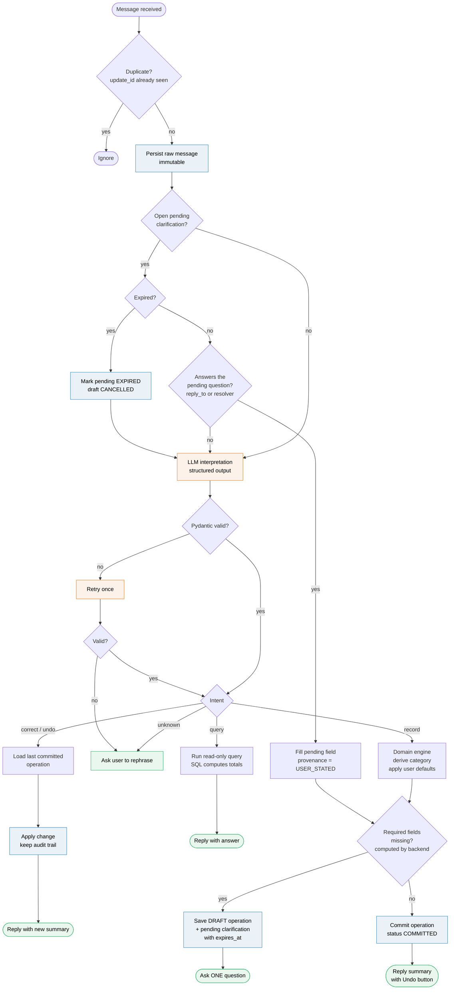

# Conversation flow

How milo turns one incoming message into a reply. The LLM interprets; the backend decides.

To edit in draw.io: Arrange → Insert → Advanced → Mermaid, then paste the block above.

## Intents

Domain-level intents (what the user wants), not CRUD verbs.

| Intent | Example | Writes? |
|---|---|---|
| `record_expense` | "combustivel entregas 30" | yes |
| `record_income` | "recebi 200 do frete" | yes |
| `record_deliveries` | "entregas realizadas 160" | yes |
| `create_reminder` | "me lembra de pagar o cartão dia 10" | yes |
| `query` | "quanto gastei de combustível esse mês?" | no |
| `correct_last` | "não, foi 130" | yes |
| `undo_last` | "apaga o último" | yes |
| `unknown` | anything else | no |

Answering a pending question is **not** an intent: it is resolved by routing (pending state) before interpretation.

## Entities

| Entity | Key fields | Notes |
|---|---|---|
| `Message` | id, user_id, channel, external_id, text, received_at | Immutable. `external_id` = Telegram update_id (dedup). |
| `Interpretation` | id, message_id, payload (JSONB), model, prompt_version, created_at | Raw LLM output, kept for evals. |
| `Operation` | id, user_id, kind, status, source_message_id, created_at | Status: `draft` → `committed` / `cancelled`. |
| `Transaction` | operation_id, type, amount (Decimal), description, category_id, asset_id?, purpose, tags[], occurred_at | `description` keeps the user's words ("chaveiro"). |
| `DeliveryRecord` | operation_id, quantity, amount?, occurred_at | |
| `Reminder` | operation_id, title, due_at, recurrence?, amount? | Fired by scheduler, not by the LLM. |
| `Category` | id, user_id?, parent_id?, name, slug | Data, not enum. `user_id` null = system default. Max 2 levels. |
| `Asset` | id, user_id, kind (vehicle/home), name, is_default | "Fox", "Yes 125", "Casa". |
| `PendingClarification` | id, conversation_id, operation_id, field, prompt_message_id, status, expires_at | One open per conversation (v1). |
| `FieldProvenance` | operation_id, field, source | `user_stated` / `user_confirmed` / `default` / `derived`. |

## Closed enums (code)

- `TransactionType`: expense, income
- `Purpose`: work, personal (drives delivery-profit reports)
- `OperationStatus`: draft, committed, cancelled
- `ProvenanceSource`: user_stated, user_confirmed, default, derived

## Business rules

1. **No invention.** A required field is filled only by the user, an explicit user default, or a deterministic derivation. Never by an LLM guess.
2. **Backend computes missing fields.** Required fields are defined per operation kind in code; the LLM never reports `missing_fields`.
3. **Ask one question at a time**, and only for required fields.
4. **Asset is required only when ambiguous**: if the user has one asset of the relevant kind, use it (`derived`); if a default exists, use it and show it with a change button (`default`).
5. **Category can depend on asset** (chaveiro + casa → Residencial > Manutenção; chaveiro + carro → Transporte > Manutenção de veículo). Derived by rule, not by the LLM.
6. **Money is `Decimal`**, never float.
7. **Totals come from SQL**, never from the LLM.
8. **Pending clarifications expire** (default 30 min); expired drafts are cancelled, not committed.
9. **A reply to the bot's question (Telegram `reply_to_message_id`) always targets that pending clarification.**
10. **A new, unrelated message while a question is pending** is processed as new; the pending stays open until it expires.
11. **Corrections never overwrite silently**: the change is recorded with its source message.
12. **Duplicates are ignored** by `(channel, external_id)` unique constraint.
