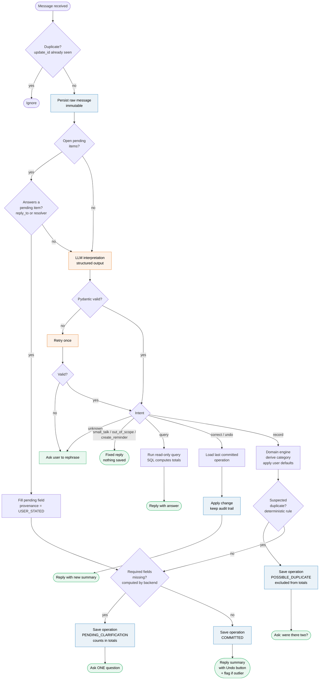

# Conversation flow

How milo turns one incoming message into a reply. The LLM interprets; the backend decides.
Product rules behind this flow live in [`PRODUCT.md`](PRODUCT.md); v1 domain decisions (M1–M8) in [`domain-v1.md`](domain-v1.md).

To edit in draw.io: Arrange → Insert → Advanced → Mermaid, then paste the block above.

Runs outside this flow, on the scheduler: the **daily closing (20:00)** sends the day's summary, open pending items and suspected duplicates, then moves unanswered items to `UNCLASSIFIED` (pending) or `COMMITTED` + flagged (duplicates). See `PRODUCT.md` §5.3–5.5.

## Intents

Domain-level intents (what the user wants), not CRUD verbs.

| Intent | Example | Writes? |
|---|---|---|
| `record_expense` | "combustivel entregas 30" | yes |
| `record_income` | "recebi 200 do frete" | yes |
| `query` | "quanto gastei de combustível esse mês?" | no |
| `correct_last` | "não, foi 130" | yes |
| `undo_last` | "apaga o último" | yes |
| `create_reminder` | "me lembra de pagar o cartão dia 10" | no — recognized, unsupported in v1 |
| `out_of_scope` | "qual o melhor celular até 2 mil?" | no |
| `small_talk` | "bom dia", "valeu" | no |
| `unknown` | anything Milo did not understand | no |

Answering a pending question is **not** an intent: it is resolved by routing (pending state) before interpretation.

## Entities

| Entity | Key fields | Notes |
|---|---|---|
| `Message` | id, user_id, channel, external_id, text, received_at | Immutable. `external_id` = Telegram update_id (dedup). |
| `Interpretation` | id, message_id, payload (JSONB), model, prompt_version, created_at | Raw LLM output, kept for evals. |
| `Operation` | id, user_id, kind, status, source_message_id, created_at | Status: see `OperationStatus`. Recorded immediately; never a draft. |
| `Transaction` | operation_id, type, amount (Decimal), description, category_id, asset_id?, purpose, tags[], occurred_at | `description` keeps the user's words ("chaveiro"). |
| `Category` | id, user_id?, parent_id?, name, slug | Data, not enum. `user_id` null = system default. Max 2 levels. |
| `Asset` | id, user_id, kind (vehicle/home), name, is_default | "Fox", "Yes 125", "Casa". |
| `PendingClarification` | id, user_id, operation_id, field, prompt_message_id, status, asked_at, reminders_sent, closed_at?, close_reason? | Several may be open per user. Never expires into data loss; closed only after ≥1 daily closing. |
| `FieldProvenance` | operation_id, field, source | `user_stated` / `user_confirmed` / `default` / `derived`. |
| `OperationEvent` | id, operation_id, kind, old_value?, new_value?, source_message_id?, source (user/scheduler), created_at | Append-only history (M8). |
| `Confirmation` | id, user_id, action, target_operation_ids, prompt_message_id, status, expires_at | [Yes]/[No] and [Redo]; valid 15 min (M4). |
| `LearnedRule` | id, user_id, kind (alias/default), pattern, target, confirmed_at | Only created after the user's yes (D7, D15). |
| `DailyClosing` | user_id, date, sent_at | One per user per date (idempotency, M7). |

Reminders and income-activity records are not part of v1.

## Closed enums (code)

- `TransactionType`: expense, income
- `Purpose`: work, personal (drives income-activity reports; see open question Q1 in `PRODUCT.md`)
- `OperationStatus`: pending_clarification, possible_duplicate, unclassified, committed, cancelled
- `PendingStatus`: open, answered, closed_no_response
- `ProvenanceSource`: user_stated, user_confirmed, default, derived

## Business rules

1. **No invention.** A required field is filled only by the user, an explicit user default, or a deterministic derivation. Never by an LLM guess.
2. **Backend computes missing fields.** Required fields are defined per operation kind in code; the LLM never reports `missing_fields`.
3. **Ask one question at a time**, and only for required fields.
4. **Asset is required only when ambiguous**: if the user has one asset of the relevant kind, use it (`derived`); if a default exists, use it and show it with a change button (`default`). A pattern seen in history never becomes a default on its own: Milo asks once and only a "yes" creates the default.
5. **Category assignment is layered**: (1) learned mappings and deterministic rules first — including asset-dependent ones (chaveiro + casa → `housing` > `home_maintenance`; chaveiro + carro → `transport` > `vehicle_maintenance`); (2) otherwise the LLM picks among **existing** categories; (3) if none fits, the operation stays pending with a suggestion. New categories and assets require the user's explicit yes.
6. **Money is `Decimal`**, never float.
7. **Totals come from SQL**, never from the LLM.
8. **Pending clarifications never lose data.** A record with a known amount is saved immediately as `pending_clarification` and counts in totals. Follow-up happens in the daily closing (20:00); after appearing in at least one closing without an answer, it becomes `unclassified` and can still be completed later.
9. **A reply to the bot's question (Telegram `reply_to_message_id`) always targets that pending clarification.**
10. **A new, unrelated message while a question is pending** is processed as new; the pending stays open and is followed up in the daily closing.
11. **Corrections never overwrite silently**: the change is recorded with its source message.
12. **Duplicate messages are ignored** by `(channel, external_id)` unique constraint.
13. **Suspected duplicate records** (deterministic rule) are saved as `possible_duplicate`, excluded from totals until confirmed; unanswered, they are committed and flagged in the daily closing.
14. **When in doubt, save and flag — never block.** Nothing is saved only when no amount is identifiable or when it would clearly duplicate an existing record (e.g., a bill already paid).
